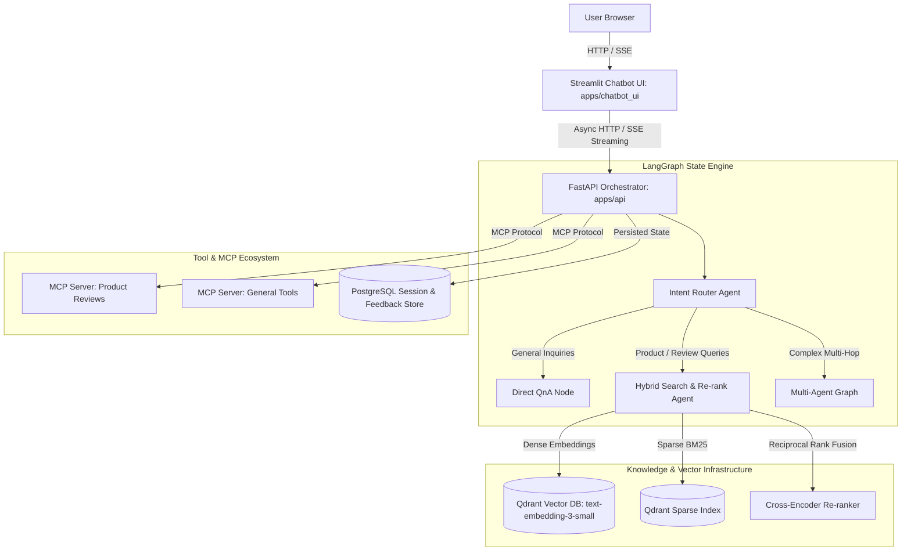

# Enterprise Multi-Agent AI Chatbot & Retrieval Platform

An end-to-end, production-grade conversational AI platform powered by **LangGraph**, **FastAPI**, **Streamlit**, **Model Context Protocol (MCP)**, and **Qdrant Hybrid Vector Search**.

---

## 🏛️ System Architecture

The platform follows a decoupled, cloud-native microservices architecture:



---

## 🌟 Key Features

- **Decoupled Architecture**: Independent FastAPI core service, Streamlit UI, and MCP server containers.
- **Agentic Routing with LangGraph**: State-driven multi-agent routing with query rewriting, expansion, and intent classification.
- **Hybrid Search & Re-Ranking**: Combining dense vector embeddings (OpenAI `text-embedding-3-small`) with sparse BM25 retrieval and Cross-Encoder re-ranking.
- **Real-Time Streaming**: Low-latency Server-Sent Events (SSE) streaming tokens directly to the frontend.
- **Model Context Protocol (MCP)**: Native integration with MCP servers exposing domain-specific tools (Amazon customer reviews and live inventory).
- **Comprehensive Evaluation**: Automated retrieval evaluation harness (`apps/api/src/api/evals/eval_retriever.py`) measuring MRR, Hit Rate, and Answer Faithfulness.

---

## 📁 Repository Structure

```
.
├── apps/
│   ├── api/                     # FastAPI core backend service
│   │   ├── src/api/agents/      # LangGraph workflows (single, multi, and prod retrieval agents)
│   │   ├── src/api/api/         # REST & SSE endpoints, middleware, models
│   │   ├── src/api/evals/       # RAG retrieval evaluation harness
│   │   └── src/api/prompts/     # Versioned YAML prompt templates
│   ├── chatbot_ui/              # Streamlit conversational web interface
│   ├── mcp_server/              # General-purpose Model Context Protocol server
│   └── mcp_server_reviews/      # Dedicated MCP server for Amazon review analytics
├── data/                        # Sample datasets, chunk embeddings, and evaluation benchmarks
├── notebooks/                   # R&D notebooks (Week 1–4: RAG, LangGraph, Routing, Streaming)
├── docker-compose.yml           # Complete local multi-container stack
├── pyproject.toml               # Unified project metadata & dependency management
└── Makefile                     # Developer productivity shortcuts
```

---

## 🚀 Quickstart

### Prerequisites
- Python 3.12+ (or `uv`)
- Docker & Docker Compose

### 1. Configuration
```bash
cp env.example .env
# Fill in your OPENAI_API_KEY, GROQ_API_KEY, and QDRANT_URL
```

### 2. Local Docker Stack
```bash
docker-compose up -d --build
```
- **Chatbot UI**: http://localhost:8501
- **FastAPI Docs**: http://localhost:8000/docs
- **Qdrant Web UI**: http://localhost:6333/dashboard

---

## 📊 Evaluation & Metrics

Run automated retriever evaluation across golden query sets:
```bash
uv run python apps/api/src/api/evals/eval_retriever.py
```

---

## 👤 Author
**Kishor Kumar Paroi**  
GitHub: [@KishorKumarParoi](https://github.com/KishorKumarParoi)
